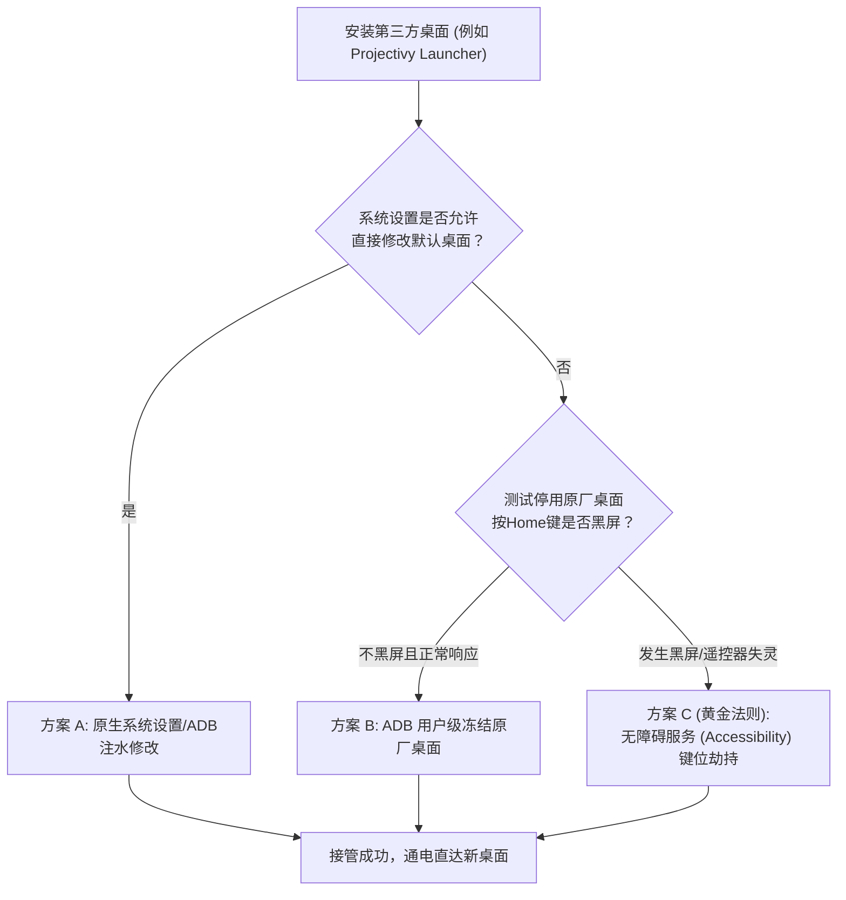

# 03. 第三方桌面全景选型与防踢接管指南

国内智能电视原厂桌面（如小米 PatchWall、海信聚好看等）通常充斥着大量影视推销、儿童专区诱导充值、短视频信息流，冷启动慢且极度消耗 RAM。替换为精简、纯粹的第三方桌面（Launcher）是电视自定义的核心一步。

---

## 1. 2026 主流 Android TV 第三方桌面深度横评

| 桌面名称 | 渲染核心 | 开源/收费 | 国内网络依赖 | 遥控器体验 | 核心亮点与优劣评估 | 推荐指数与受众 |
| :--- | :--- | :--- | :--- | :--- | :--- | :--- |
| **Projectivy Launcher** *(强烈推荐)* | 原生 Leanback | 开源免费 (Google Play有内购支持) | **零依赖** (离线完美可用) | **原生级极致流畅** | **当前全球社区综合评价第一**。<br>1. 内置无障碍 Home 键强力劫持机制（免 Root 破除原厂桌面反弹）；<br>2. 支持 HDMI 信号源直达磁贴；<br>3. 允许按行自定义应用分类与影视流聚合；<br>4. 零遥测、零广告。 | ⭐⭐⭐⭐⭐<br>**极客与追求流畅体验首选** |
| **Emotn UI** | 现代 Android UI | 闭源免费 | **零依赖** (内置国内天气源) | **长辈友好度最高** | 1. 界面大图标设计，符合传统大屏交互直觉；<br>2. 开箱即用的国内城市天气插件；<br>3. 壁纸更换便捷，支持极简模式。缺点为闭源商业软件。 | ⭐⭐⭐⭐☆<br>**家庭老幼、极简实用派首选** |
| **FLauncher** | Flutter 引擎 | 开源免费 | **零依赖** | 良好 | 1. 基于 Flutter 构建的现代极简界面；<br>2. 仅提供应用分组与网格排布，极致纯粹；<br>3. 内存开销极小。缺点是无法添加 HDMI 信号源快捷卡片。 | ⭐⭐⭐⭐<br>**极简主义、开源死忠粉** |
| **ATV Launcher (Pro)** | AOSP Grid | 闭源 (Pro收费) | **零依赖** | 良好 | 1. 经典磁贴网格风格；<br>2. 原生支持 Android Widget 小部件（如时钟、硬件监控）；<br>3. 支持隐藏应用与密码锁保护。缺点是近期更新迭代较慢。 | ⭐⭐⭐☆<br>**喜爱桌面小部件与自定义排版** |

---

## 2. 国产电视“锁死桌面”与“反弹”机理解析

在普通 Android 手机或原生 Android TV 上，安装完新桌面后按 Home 键会弹出“选择主屏幕应用”；但在国产定制 ROM 上，厂商通过以下三种手段强制锁定原厂桌面：

1. **隐藏/阉割默认桌面选择菜单**：系统“设置”中移除了“默认应用 (Default Apps)”入口。
2. **硬编码 Home 键分发**：系统底层的 `PhoneWindowManager` 在拦截到遥控器 `KEYCODE_HOME` 时，强行指定由厂商专有包（如 `com.mitv.tvhome`）响应。
3. **自愈防冻机制**：开机自启守护服务检测到系统桌面未运行时，强行重新拉起或抛出黑屏警告。

---

## 3. 三级接管方案（从温和到终极防踢）

针对上述对抗策略，推荐由浅入深的三级接管路径：



---

### 方案 A：系统属性注水（部分开放机型）

如果电视保留了原生 Android 的桌面分发能力，可通过 ADB 指令直接向系统指定默认 Home Activity：

```cmd
:: 1. 安装 Projectivy Launcher (将 apk 放入工作区 apk/ 目录下)
adb install -r apk/Projectivy_Launcher.apk

:: 2. 查询第三方桌面的主入口 Activity
adb shell cmd package resolve-activity -c android.intent.category.HOME -a android.intent.action.MAIN

:: 3. 强制指定 Projectivy 为默认 Home 应用 (包名/Activity)
adb shell cmd package set-home-activity com.spocky.projengmenu/.fragment.browse.BrowseActivity
```

---

### 方案 B：原厂桌面用户级冷冻（视机型而定）

如果方案 A 无效，且安装了第三方桌面后，可尝试冻结原厂桌面：

```cmd
:: 针对小米电视 (注意风险：老版本 MIUI TV 可能会导致 Home 键无响应)
adb shell pm disable-user --user 0 com.mitv.tvhome

:: 针对海信电视聚好看桌面
adb shell pm disable-user --user 0 com.jamdeo.tv.vod
```

> [!WARNING]
> **黑屏熔断预案**：
> 执行冻结前，确保电脑与电视的 ADB 处于已连接状态！如果按下遥控器 Home 键后屏幕陷入全黑，请立即在电脑端输入恢复指令：
> `adb shell pm enable com.mitv.tvhome`，然后改用下述 **方案 C**。

---

### 方案 C（黄金法则）：无障碍服务（Accessibility）键位劫持

这是目前应对国产电视防篡改机制**最稳定、零黑屏风险、100% 成功**的方案。

#### 原理说明
保持原厂系统桌面完好运行，在电视上开启 **Projectivy Launcher 内置的无障碍服务**。该服务会在遥控器按下 `Home` 键的瞬间，在底层硬件按键分发阶段抢先捕获 `KEYCODE_HOME` 事件并直接将画面切换为 Projectivy 界面，使厂商的系统桌面根本没有机会弹出。

#### 详细实施步骤

1. **安装 Projectivy Launcher**：
   ```cmd
   adb install -r apk/Projectivy_Launcher.apk
   ```
2. **通过 ADB 赋予无障碍服务与通知监听权限**：
   *（这一步免去在电视遥控器上寻找隐藏设置的繁琐步骤）*
   ```cmd
   :: 激活 Projectivy 的无障碍事件监听服务
   adb shell settings put secure enabled_accessibility_services com.spocky.projengmenu/.services.AccessibilityService
   adb shell settings put secure accessibility_enabled 1
   ```
3. **在电视端进入 Projectivy 设置开启覆盖**：
   - 从电视原有桌面打开一次“Projectivy Launcher”。
   - 按遥控器菜单键进入 Projectivy 的 **“Projectivy 设置 (Settings)”** -> **“常规 (General)”**。
   - 找到 **“覆盖默认桌面 (Override current Launcher)”** 并勾选。
   - 勾选 **“开机自启 (Start on boot)”**。
4. **终极测试**：
   - 此时在任意应用界面或原厂桌面下，按一下遥控器的 **“主页键 (Home)”**，电视都会在 0.1 秒内无缝切回 Projectivy Launcher！
   - 重启电视测试，电视开机完成后将自动直达清爽的 Projectivy 界面。

