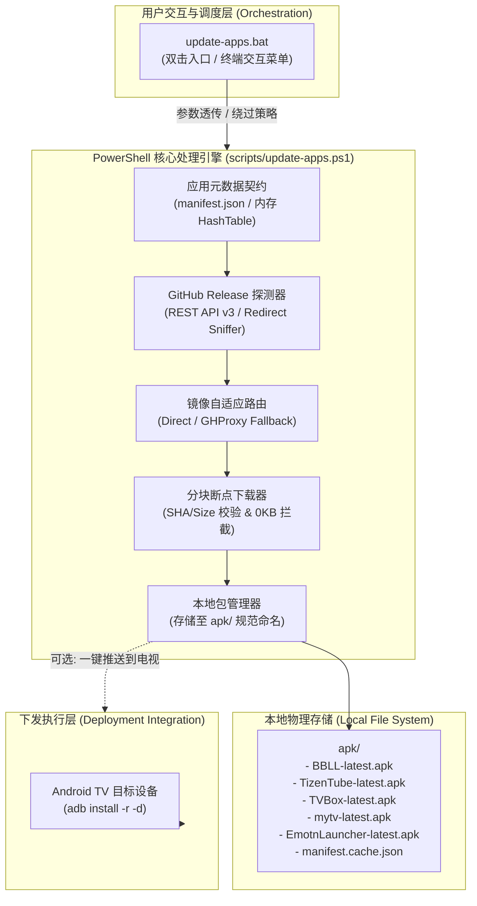
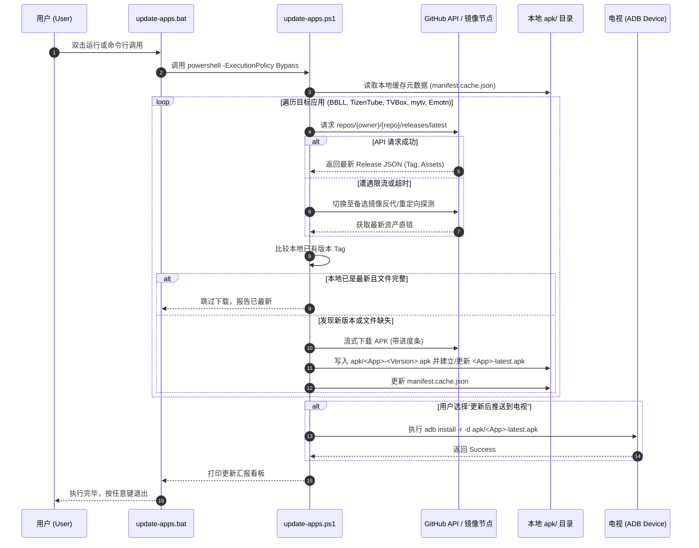

# 电视核心应用一键更新与离线包归档方案设计规范

> **文档标识**：`doc/feat/01_app_auto_update_scheme.md`  
> **编制角色**：System Analyst (`/analyzer`)  
> **状态**：方案设计归档 (Pending Builder Implementation)  
> **面向宿主**：Windows 10/11 (PowerShell 5.1+ / Batch) + Android TV (ADB)

---

## 1. 方案背景与目标 (Background & Objectives)

### 1.1 现状与痛点
1. **多源维护繁琐**：电视端常用开源增强与轻量应用（如哔哩哔哩第三方客户端 **BBLL**、YouTube 去广告/Cobalt 核心客户端 **TizenTube Cobalt / SmartTube**、影视聚合播放器 **TVBox / FongMi**、电视极速直播 **mytv-android** 以及长辈友好型纯净桌面 **Emotn Launcher**）迭代频繁且分发源分散。
2. **国内网络受阻**：直接从原生 `github.com/.../releases/download/` 拉取 APK 经常遭遇 DNS 污染、TCP 连接重置或握手超时，导致下载失败或产生 0KB 损坏包。
3. **版本滞后与装机割裂**：每次更新需要用户在 PC 端网页翻找 Release、逐个点击下载、插拔 U 盘或手动输入 `adb install`，缺乏端到端的一键更新与版本基准追溯。

### 1.2 建设目标
- **单一真相源**：在本地 `apk/` 目录下建立结构化的应用归档库，保持各重要 TV 应用始终为最新稳定版。
- **双模开箱即用**：提供 Windows 下双击即跑的批处理入口（`.bat`）与高健壮性的后台解析引擎（`.ps1`），无需用户配置复杂 Python 环境。
- **智能镜像降级**：内置 GitHub API 直连 + 多节点反代镜像加速（如 `ghproxy.net` / `mirror.ghproxy.com`）自适应切换，彻底解决网络抖动。
- **无缝衔接 ADB 运维链**：与工作区现有的 `scripts/tv-connect.bat` 深度联动，支持“仅下载更新到本地”与“下载并一键推送到电视覆盖安装”两种操作模式。

---

## 2. 事实基准与应用清单矩阵 (Fact Grounding Matrix)

通过对开源电视生态与 GitHub Release 规范的检索查证，确定首批纳管的核心应用元数据基准如下：

| 应用简称 | 完整项目定位 | 权威分发渠道 / 仓库 | 发布资产 (Asset) 匹配规则 | 架构说明 | 依赖门禁 |
| :--- | :--- | :--- | :--- | :--- | :--- |
| **BlBl (BBLL)** | 哔哩哔哩 TV/Pad 开源第三方客户端 | `xiaye13579/BBLL` | `*release*.apk` (排除 debug 包) | 推荐 universal 通用架构 | Android 5.0+ |
| **TizenTube** | YouTube TV Cobalt 核心去广告版 (或 SmartTube) | `reisxd/TizenTubeCobalt` *(备用: `yuliskov/SmartTube`)* | `*Cobalt*.apk` 或 `*arm*.apk` | 适配 Android TV Cobalt 渲染 | Android 4.4+ |
| **TVBox** | 开源空壳点播/直播聚合播放器 (FongMi 内核) | `FongMi/Release` *(或 `q215613905/TVBoxOS`)* | `*leanback*.apk` 或 `*java*.apk` | 专为遥控器 D-Pad 交互定制 | Android 5.0+ |
| **mytv-android** | 极简电视直播 (IPTV) 客户端 | `mytv-android/mytv-android` | `*release*.apk` | 专为遥控器切台优化，开机直达秒播 | Android 5.0+ |
| **Emotn Launcher** | 经典大图标长辈友好型纯净桌面 | 官方分发 `app.emotn.com` *(或静态托管直链)* | `*Emotn*.apk` 或固定归档包 | 极简大图标、支持国内天气插件、老幼皆宜 | Android 4.4+ |

> [!NOTE]
> **技术事实说明**：  
> 1. **TizenTube / SmartTube**：原生 TizenTube 运行于三星 Tizen 操作系统（`.wgt` 格式）。在 Android TV 生态中，同作者/社区移植版为 **TizenTube Cobalt**。为兼顾兼容性，方案支持在清单中灵活切换为该生态最广泛使用的 **SmartTube** (`yuliskov/SmartTube`)。  
> 2. **Emotn Launcher**：属于闭源免费桌面软件（无开放 GitHub Releases API），其官方门户为 `app.emotn.com`。在 `AppRegistry` 中，将其配置为“静态直链/CDN 托管源”，下载引擎自适应支持直接 URL 流式下载与体积校验，与其他 GitHub 动态 Releases 应用统一落盘管理。

---

## 3. 总体架构与数据流模型 (System Architecture & Data Flow)

### 3.1 模块分层架构



### 3.2 核心更新控制流程



---

## 4. 脚本编制方案与核心技术设计 (Script Engineering Specification)

### 4.1 技术栈选型决策

| 维度 | 方案 A: 纯批处理 (`.bat` + `curl.exe`) | 方案 B: `PowerShell` 引擎 + `.bat` 门面 (推荐) | 方案 C: `Python` 脚本 (`requests`) |
| :--- | :--- | :--- | :--- |
| **运行时依赖** | 依赖 Win10+ 自带 curl，解析复杂 JSON 极其脆弱 | **零外部依赖**，Windows 7+ 均预装 PowerShell 5.1+ | 需用户额外安装 Python 及三方库，门槛高 |
| **JSON 处理** | 必须借助复杂 `findstr` 或临时 VBScript | 原生 `ConvertFrom-Json`，强类型字典操作 | 极佳 |
| **网络鲁棒性** | 缺乏细粒度 TLS 与 Header 控制 | 原生支持 TLS 1.2/1.3、自定义 User-Agent 与超时熔断 | 极佳 |
| **用户体验** | 纯命令行黑框，进度显示原始 | 原生 `Write-Progress` 友好进度条，色彩分级明确 | 依赖终端库 |

**决策结论**：采用 **方案 B**。对外提供统一的 `scripts/update-apps.bat`，内部通过 `PowerShell.exe -ExecutionPolicy Bypass -File update-apps.ps1` 调度主逻辑，兼顾免安装便利性与生产级脚本健壮性。

### 4.2 模块架构与文件布局规划

拟在工程中落地的文件清单与职责划分：

```text
androidTV/
├── apk/                             # APK 归档目标目录
│   ├── BBLL-latest.apk              # 符号链接或标准化重命名副本
│   ├── TizenTube-latest.apk
│   ├── TVBox-latest.apk
│   ├── mytv-latest.apk
│   ├── EmotnLauncher-latest.apk
│   └── .manifest.cache.json         # 记录各组件当前已下载版本与哈希
├── doc/
│   └── feat/
│       └── 01_app_auto_update_scheme.md   # 本设计方案规范
└── scripts/
    ├── update-apps.bat              # [新增] 双击运行的入口批处理
    ├── update-apps.ps1              # [新增] 核心下载与版本比对引擎
    └── modules/
        └── AppRegistry.psd1         # [新增/内嵌] 应用元数据源定义
```

### 4.3 核心逻辑关键算法设计

#### 1. 网络镜像与反代降级策略
为了防御 GitHub API 频率限制（未认证 IP 每小时仅 60 次）以及国内下载阻断，下载引擎采用三级容灾矩阵：
- **Primary**：`https://api.github.com/repos/{owner}/{repo}/releases/latest`（官方标准）
- **Mirror List**：
  - `https://ghproxy.net/https://github.com/{owner}/{repo}/releases/download/...`
  - `https://mirror.ghproxy.com/https://github.com/{owner}/{repo}/releases/download/...`
  - `https://kkgithub.com/...`
- **Fallback 机制**：下载采用 HTTP 探针，若返回码非 200 或握手超时（>8s），自动顺延至下一镜像重试，最多重试 3 次。

#### 2. 包完整性与 0KB 防御
在下载完成进入 `apk/` 目录前，必须通过以下硬门禁：
1. **HTTP Status Code** 严格等于 200。
2. **物理文件体积门禁**：APK 体积必须 $\ge 5\,\text{MB}$。若 $< 5\,\text{MB}$，判定为反代劫持报错页或断流坏包，直接销毁并告警，禁止覆盖现有 `latest.apk`。
3. **原子性写入**：先下载至 `apk/.tmp_<name>.apk`，全量校验通过后原子重命名至目标路径。

#### 3. 与现有 ADB 工具链协同 (Optional Pipeline)
下载完成后，脚本探测当前是否存在已连接的 ADB 电视设备：
- 若存在已授权的设备（`adb get-state` 返回 `device`），提供一键覆写安装选项：
  ```cmd
  adb install -r -d -g apk/BBLL-latest.apk
  ```
  （`-r` 保留数据替换，`-d` 允许降级覆盖，`-g` 授予运行时所有默认权限）

---

## 5. 实施路线图与 WBS (Work Breakdown Structure)

本方案经评审批准后，将分阶段移交 `/builder` 开展代码实施：

- [ ] **Phase 1: 基础设施与应用清单契约配置**
  - 在 `scripts/` 中规范化配置应用元数据（包含 GitHub Repo、Asset 正则表达式、架构要求）。
  - 创建并确保 `apk/` 目录权限及 `.gitignore` 规则（忽略大型 `.apk`，保留 `.gitkeep`）。
- [ ] **Phase 2: 核心下载与版本调度引擎 (`scripts/update-apps.ps1`)**
  - 实现 TLS 1.2 强制协商与 GitHub API 资产解析逻辑。
  - 实现镜像加速链轮询器与断点重试下载逻辑。
  - 实现体积门禁与 `apk/` 归档版本持久化（`.manifest.cache.json`）。
- [ ] **Phase 3: 双击交互批处理外壳 (`scripts/update-apps.bat`)**
  - 编写编码与环境初始化脚本（`chcp 65001`）。
  - 实现参数转发与模式选择（1. 仅下载最新 APK；2. 下载并一键安装到电视；3. 检查更新状态）。
- [ ] **Phase 4: 全流程联调与白盒验收**
  - 在真实 Windows 终端下运行测试，验证国内网络下的镜像下载成功率。
  - 接入 ADB 电视环境，验证应用静默覆盖升级能力。

---

## 6. 质量门禁与验收标准 (Acceptance Criteria)

1. **执行零报错门禁**：在无第三方环境污染的裸机 Windows 10/11 环境下，双击 `scripts/update-apps.bat` 能够无障碍启动并正确捕获各应用最新 Release。
2. **下载准确性门禁**：`apk/` 目录下成功生成各应用的最新安装包，无 0KB 坏包，APK 解包签名结构有效。
3. **网络自愈容错率**：人为模拟原生 GitHub API 超时时，脚本能够自动切入加速镜像节点并顺利拉取安装包。
4. **架构合规**：不篡改 `scripts/` 已有脚本功能，严格遵循项目现有命令规范与 UTF-8 编码约束。

