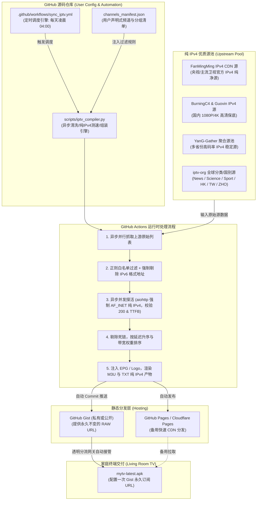

# mytv-android 专属自选订阅源与透明分流架构方案设计规范

> **文档标识**：`doc/feat/02_mytv_subscription_scheme.md`  
> **编制角色**：Production Builder (`/builder`) / System Analyst (`/analyzer`)  
> **状态**：方案修订归档 (Aligned with 20261108 Review Gate)  
> **面向终端**：Android TV (`mytv-latest.apk` / mytv-android) + 路由级透明分流网关 (Clash Meta / Sing-box / OpenWrt 纯 IPv4 单栈环境)  
> **托管架构**：纯云端无人值守体系 (GitHub Actions + Gist / Pages 静态分发)

---

## 1. 方案背景与建设目标 (Background & Objectives)

### 1.1 现状与核心痛点
1. **公共源冗余与劣质台充斥**：网络公开发布的 IPTV 聚合源通常包含数百乃至上千个频道，其中夹杂大量低清省市县级台、购物轮播频道及海外失效死链。在电视端依靠遥控器上下翻页选台极为繁琐，长辈与家庭成员体验极差。
2. **缺乏个性化自选能力**：用户无法按家庭习惯定制“我想要的电视频道列表”（例如仅保留央视高清全套、头部主流省级卫视、精选港澳台高清以及国际纪录片频道），更无法自主定义频道排序和分组优先级。
3. **内外网分流需求与传统播放器配置冲突**：
   - **国内频道（CCTV/卫视）**：依赖国内官方 CDN（如央视频、咪咕等）或运营商优质 IPv4 流。由于具备内地专属 CDN 边缘节点与高带宽，必须**通过 IPv4 物理直连**；若误走海外代理节点，会触发反向地域阻断或严重限速。
   - **国际/港澳台频道（TVB/凤凰/Discovery/HBO 等）**：依赖海外机房与境外流媒体分发，境内直接访问通常被阻断或遭遇严重 DNS 污染，必须**走海外特定代理节点**。
   - **网关级 DNS 污染与 IPv6 调度冲突**：在家庭局域网中，若开启 IPv6 双栈，电视端容易触发 AAAA 查询导致 DNS 泄漏、国内外流解析混乱，甚至因代理节点不支持 IPv6 转发而引发大面积黑屏。因此，**家庭透明网关明确收敛为纯 IPv4 单栈架构**。传统播放器内部缺乏精细分流与 Fake-IP 机制，必须由路由透明网关实施 IPv4 域名/IP 级的精准分流。
4. **源失效频繁与人工维护成本高**：直播源具备高度时效性，传统手动拷贝 M3U 文件的维护方式难以持久，几天不维护即出现大面积“黑屏/无限加载”。

### 1.2 建设目标
- **声明式自由选台 (Declarative Channel Selection)**：在云端维护一份高可读的结构化频道声明清单（`channels_manifest.json`），用户可按需自由启用、关闭、重命名及重排频道，精确剔除垃圾台。
- **透明网关无感分流 (Transparent Gateway Routing)**：充分依托用户现有的 IPv4 路由级透明分流网络（Clash Meta / Sing-box / OpenWrt），M3U/TXT 订阅源输出纯净标准 IPv4 URL，实现“国内源自动直连、海外源自动代理”，客户端无需任何复杂改动。
- **纯云端无人值守运维 (Serverless & Zero-Maintenance)**：基于 GitHub Actions 每日自动化执行“全网拉取 $\to$ 规则筛选 $\to$ 异步并发测速清洗（强制 IPv4 过滤与 Socket 探活） $\to$ 优选排序与 EPG 注入 $\to$ Gist/Pages 静态发布”，免除本地搭建 Docker 或常开 PC 的运维负担。
- **一处订阅，永久静默更新**：为 `mytv-latest.apk` 提供固定的永久订阅地址（同时兼容 M3U 与 TXT 格式），电视端只需通过局域网网页管理面板配置一次，后续全自动同步最新可用线路。

---

## 2. 事实基准与分流网络契约 (Fact Grounding Matrix)

### 2.1 播放器端物理事实契约 (`mytv-android`)

依据对 `mytv-android` (v2.x+ 核心) 源码规范与运行时机制的查证，其核心接口与协议边界如下：

| 特性维度 | 客户端规格 / 物理约束 | 架构影响与应对策略 |
| :--- | :--- | :--- |
| **支持的播放列表格式** | 1. 标准扩展 **M3U** (`#EXTM3U` + `#EXTINF`)<br>2. 经典国内 **TXT** 格式 (`分组名,#genre#` + `频道名,URL`) | 订阅构建引擎必须同时输出 `.m3u` 与 `.txt` 两份产物，满足用户不同场景偏好。 |
| **EPG 节目单绑定** | 支持在 M3U 头注入 `x-tvg-url` 属性，或在 `#EXTINF` 中通过 `tvg-name` / `tvg-id` 关联 XMLTV 规范的 EPG 源 | 构建引擎需建立标准 EPG 字典映射表，在组装 M3U 时自动填充标准的 `tvg-name` 与台标 `tvg-logo`。 |
| **多源线路切换** | 同一频道支持多个备用 URL。在 M3U 中表现为相同 `tvg-name` 或相同频道名连续声明；遥控器按左右键可即时切换线路 | 构建引擎需对同一频道的多条上游候选源进行并发健康探测，按“首包耗时 (TTFB)”升序排列，保留前 3~5 条最优线路。 |
| **网络请求与代理机制** | 应用层基于 Android ExoPlayer (Media3) / IJK 内核；内部无针对单个流的复杂规则分流引擎 | **坚决不在 APK 内部开启全局代理**，完全交由上层路由透明网关实施 IPv4 分流。 |
| **IP 协议族约束** | 电视端运行于纯 IPv4 局域网环境，无全局 IPv6 路由与 AAAA 解析支持 | **严禁在订阅中注入 IPv6 字面量地址（如 `[2409:...]`）**，否则在 ExoPlayer 初始化握手时将直接触发 `ENETUNREACH` 错误。 |
| **远程订阅拉取限制** | 电视端网络受限环境拉取大体积订阅可能超时（> 5MB 或条目过千容易引起列表解析卡顿） | 定制精选列表条目收敛至 50~120 个核心台，产物大小控制在 100KB 以内，秒级完成解析。 |

### 2.2 路由级透明分流拓扑契约 (Network Diversion Contract)

在家庭局域网中，电视设备网关与 DNS 指向透明分流路由器（如 OpenWrt / iStoreOS / 旁路由 Clash Meta / Sing-box）。网络拓扑与流量分流契约定义如下：

```
                ┌────────────────────────────────────────────────────────┐
                │             Android TV (运行 mytv-latest.apk)          │
                │        订阅: https://gist.githubusercontent.com/...     │
                │        (纯 IPv4 单栈环境，分配内网 IPv4: 192.168.x.x)  │
                └───────────────────────────┬────────────────────────────┘
                                            │ 发起播放请求 (标准 HTTP/HLS)
                                            ▼
                ┌────────────────────────────────────────────────────────┐
                │          家庭透明网关 (Clash Meta / Sing-box)           │
                │       - 纯 IPv4 运作 (禁用 AAAA 解析，避免 DNS 污染)    │
                │       - Fake-IP 模式 (198.18.0.0/16 快速接管媒体请求)   │
                │       - 依据 GEOSITE / GEOIP:CN (IPv4 chnroute) 分流    │
                └───────────────┬────────────────────────┬───────────────┘
                                │                        │
         [国内直连规则命中]      │                        │ [境外/港澳台规则命中]
 (GEOSITE:CN / GEOIP:CN IPv4)   │                        │ (GEOSITE:geolocation-!cn / 境外IP)
                                ▼                        ▼
                ┌────────────────────────┐      ┌────────────────────────┐
                │ 运营商物理光猫 / 直连   │      │ 优质低延迟代理节点      │
                │ - CCTV / 各省卫视      │      │ (香港 / 台湾 / 新加坡)  │
                │ - 央视频 / 咪咕 IPv4   │      │ - 凤凰卫视 / TVB 翡翠台 │
                │ - 官方 CDN 边缘节点    │      │ - HBO / Discovery / CNN│
                └────────────────────────┘      └────────────────────────┘
```

#### 2.2.1 分流规则判定矩阵：
- **DIRECT 链路（国内高可用）**：
  - **域名规则集**：`GEOSITE,CN,DIRECT`、`DOMAIN-SUFFIX,cctv.cn,DIRECT`、`DOMAIN-SUFFIX,yangshipin.cn,DIRECT`、`DOMAIN-SUFFIX,miguvideo.com,DIRECT` 以及各省广播电视集团官方域名。
  - **IPv4 地址特征**：`GEOIP,CN,DIRECT`（基于纯 IPv4 chnroute 规则库）、本地局域网私网段。
- **PROXY 链路（国际与港澳台）**：
  - **域名规则集**：`GEOSITE,geolocation-!cn,PROXY`、`DOMAIN-SUFFIX,mytvsuper.com,PROXY`、`DOMAIN-SUFFIX,hketv.com,PROXY`、`DOMAIN-SUFFIX,viu.tv,PROXY`、`DOMAIN-SUFFIX,phoenixtv.com,PROXY`、`DOMAIN-SUFFIX,youtube.com,PROXY`、`DOMAIN-SUFFIX,akamaized.net,PROXY`。
  - **兜底规则**：未匹配国内白名单且目标 IP 为境外（`GEOIP,!CN`）的媒体流自动走代理。

#### 2.2.2 DNS 防污染与防劣化策略 (DNS Cleanliness Contract)：
1. **禁用 IPv6 AAAA 解析**：透明网关内部直接关闭 IPv6 DNS 解析器或丢弃 AAAA 查询请求，彻底杜绝因双栈 DNS 导致海外流误解析到国内污染 IP、或国内流解析到非本运营商远端节点的劣化问题。
2. **Fake-IP 模式无感代理**：针对非 CN 域名，网关直接向 TV 客户端秒级返回内部 Fake-IP（`198.18.0.0/16`）。客户端即时向该 Fake-IP 建立 TCP 握手，由网关在海外代理出站节点进行远端真实 DNS 解析，100% 免疫本地 DNS 污染。
3. **国内直连最优 CDN 调度**：国内域名交由运营商 Local DNS 或公共 DNS（`223.5.5.5` / `119.29.29.29`）直连解析，保障央视频、咪咕等 CDN 源调度到距离家庭最近的同运营商边缘服务器。

---

## 3. 总体架构与端到端数据流模型 (System Architecture)

### 3.1 纯云端无人值守架构拓扑



---

## 4. 关键模块设计与技术规范 (Module Specifications)

### 4.1 声明式频道编目规范 (`channels_manifest.json`)

系统允许用户通过声明式 JSON 清单，完全控制上游源池、频道大纲、分组归类、台标及正则命中规则。当前清单已收录 **58 个精选频道**，涵盖央视、卫视、港澳台及国际优质 FTA 频道。

```json
// config/iptv/channels_manifest.json
{
  "settings": {
    "max_lines_per_channel": 4,
    "probe_timeout_seconds": 3,
    "concurrent_probes": 50,
    "ipv4_only": true,
    "epg_urls": [
      "https://live.fanmingming.com/e.xml",
      "https://epg.112114.xyz/pp.xml"
    ],
    "default_logo_base": "https://live.fanmingming.com/tv/"
  },
  "upstream_sources": [
    { "name": "FanMingMing-ITV-IPv4", "url": "https://raw.githubusercontent.com/fanmingming/live/main/tv/m3u/itv.m3u", "type": "m3u", "ipv4_verified": true },
    { "name": "BurningC4-TV-IPV4", "url": "https://raw.githubusercontent.com/BurningC4/Chinese-IPTV/master/TV-IPV4.m3u", "type": "m3u", "ipv4_verified": true },
    { "name": "Guovin-IPv4", "url": "https://raw.githubusercontent.com/Guovin/iptv-api/gd/output/ipv4/result.m3u", "type": "m3u", "ipv4_verified": true },
    { "name": "YanG-Gather", "url": "https://raw.githubusercontent.com/YanG-1989/m3u/main/Gather.m3u", "type": "m3u", "ipv4_verified": false },
    { "name": "iptv-org-hk", "url": "https://raw.githubusercontent.com/iptv-org/iptv/master/streams/hk.m3u", "type": "m3u", "ipv4_verified": false },
    { "name": "iptv-org-zho", "url": "https://raw.githubusercontent.com/iptv-org/iptv/master/streams/zho.m3u", "type": "m3u", "ipv4_verified": false },
    { "name": "iptv-org-news", "url": "https://iptv-org.github.io/iptv/categories/news.m3u", "type": "m3u", "ipv4_verified": false },
    { "name": "iptv-org-tw", "url": "https://iptv-org.github.io/iptv/countries/tw.m3u", "type": "m3u", "ipv4_verified": false },
    { "name": "iptv-org-science", "url": "https://iptv-org.github.io/iptv/categories/science.m3u", "type": "m3u", "ipv4_verified": false },
    { "name": "iptv-org-sport", "url": "https://iptv-org.github.io/iptv/categories/sport.m3u", "type": "m3u", "ipv4_verified": false }
  ],
  "groups": [
    {
      "name": "央视频道",
      "channels": [
        /* 覆盖 CCTV 1~17、CCTV-4K 超高清、CCTV-8K 超高清 (共 19 个频道) */
        { "name": "CCTV-1 综合", "tvg_id": "CCTV1", "tvg_name": "CCTV-1 综合", "logo": "CCTV1.png", "match_patterns": ["(?i)cctv[-_\\s]?1(?!\\d)", "CCTV-1\\s*综合"] },
        { "name": "CCTV-5 体育", "tvg_id": "CCTV5", "tvg_name": "CCTV-5 体育", "logo": "CCTV5.png", "match_patterns": ["(?i)cctv[-_\\s]?5(?!\\+|\\d)", "CCTV-5\\s*体育(?!赛事)"] },
        { "name": "CCTV-13 新闻", "tvg_id": "CCTV13", "tvg_name": "CCTV-13 新闻", "logo": "CCTV13.png", "match_patterns": ["(?i)cctv[-_\\s]?13(?!\\d)", "CCTV-13\\s*新闻"] },
        { "name": "CCTV-4K 超高清", "tvg_id": "CCTV4K", "tvg_name": "CCTV-4K 超高清", "logo": "CCTV4K.png", "match_patterns": ["(?i)cctv[-_\\s]?4k", "CCTV-4K\\s*超高清"] }
      ]
    },
    {
      "name": "卫视频道",
      "channels": [
        /* 覆盖全国主流一线省级卫视 (湖南、浙江、江苏、东方、北京、广东、深圳、山东等共 15 个频道) */
        { "name": "湖南卫视", "tvg_id": "Hunan", "tvg_name": "湖南卫视", "logo": "湖南卫视.png", "match_patterns": ["湖南卫视"] },
        { "name": "浙江卫视", "tvg_id": "Zhejiang", "tvg_name": "浙江卫视", "logo": "浙江卫视.png", "match_patterns": ["浙江卫视"] },
        { "name": "东方卫视", "tvg_id": "Dragon", "tvg_name": "东方卫视", "logo": "东方卫视.png", "match_patterns": ["东方卫视", "上海东方卫视"] }
      ]
    },
    {
      "name": "港澳台精选",
      "channels": [
        /* 覆盖凤凰卫视全系、TVB 翡翠台、香港电台以及台湾优质新闻台 (共 9 个频道) */
        { "name": "凤凰中文", "tvg_id": "PHOENIX_ZH", "tvg_name": "凤凰卫视中文台", "logo": "凤凰中文.png", "match_patterns": ["凤凰中文", "凤凰卫视中文台", "(?i)phoenix.*chinese"] },
        { "name": "凤凰资讯", "tvg_id": "PHOENIX_INFO", "tvg_name": "凤凰卫视资讯台", "logo": "凤凰资讯.png", "match_patterns": ["凤凰资讯", "凤凰卫视资讯台", "(?i)phoenix.*info"] },
        { "name": "翡翠台 (TVB)", "tvg_id": "TVB_JADE", "tvg_name": "翡翠台", "logo": "翡翠台.png", "match_patterns": ["翡翠台", "(?i)tvb.*jade", "(?i)jade.*tvb"] },
        { "name": "港台电视 31", "tvg_id": "RTHK31", "tvg_name": "港台电视31", "logo": "港台电视31.png", "match_patterns": ["港台电视31", "港台电视 31", "(?i)rthk.*31"] },
        { "name": "TVBS 新闻", "tvg_id": "TVBS_NEWS", "tvg_name": "TVBS 新闻台", "logo": "TVBS.png", "match_patterns": ["(?i)tvbs.*(新闻|新聞|news)", "TVBS\\s*(新闻|新聞)"] },
        { "name": "中天新闻", "tvg_id": "CTI_NEWS", "tvg_name": "中天新闻台", "logo": "中天新闻.png", "match_patterns": ["(?i)(中天新闻|中天新聞|cti.*news)"] },
        { "name": "东森新闻", "tvg_id": "EBC_NEWS", "tvg_name": "东森新闻台", "logo": "东森新闻.png", "match_patterns": ["(?i)(东森新闻|東森新聞|ebc.*news)"] }
      ]
    },
    {
      "name": "国际与纪录片",
      "channels": [
        /* 覆盖全球顶尖 FTA 免版权时政、商业财经、自然科学与户外探险频道 (共 14 个频道) */
        { "name": "CGTN", "tvg_id": "CGTN", "tvg_name": "CGTN 英语", "logo": "CGTN.png", "match_patterns": ["(?i)\\bcgtn\\b(?!.*doc)", "CGTN\\s*英语"] },
        { "name": "国家地理", "tvg_id": "NAT_GEO", "tvg_name": "国家地理", "logo": "国家地理.png", "match_patterns": ["国家地理", "(?i)national\\s*geo"] },
        { "name": "探索频道", "tvg_id": "DISCOVERY", "tvg_name": "探索频道", "logo": "探索频道.png", "match_patterns": ["探索频道", "(?i)discovery"] },
        { "name": "NHK World", "tvg_id": "NHK_WORLD", "tvg_name": "NHK World Japan", "logo": "NHKWorld.png", "match_patterns": ["(?i)nhk\\s*world", "NHK\\s*世界"] },
        { "name": "CNA (亚洲新闻台)", "tvg_id": "CNA", "tvg_name": "CNA (Channel NewsAsia)", "logo": "CNA.png", "match_patterns": ["(?i)\\bcna\\b(?!.*doc)", "(?i)channel\\s*news\\s*asia", "新加坡亚洲新闻"] },
        { "name": "France 24 英语", "tvg_id": "FRANCE24_EN", "tvg_name": "France 24 (English)", "logo": "France24.png", "match_patterns": ["(?i)france\\s*24.*(en|english)", "(?i)france\\s*24\\s*\\(en\\)"] },
        { "name": "DW English (德国之声)", "tvg_id": "DW_EN", "tvg_name": "DW English", "logo": "DW.png", "match_patterns": ["(?i)dw\\s*english", "(?i)\\bdw\\b.*(en|english)", "德国之声"] },
        { "name": "Al Jazeera 英语", "tvg_id": "AL_JAZEERA_EN", "tvg_name": "Al Jazeera (English)", "logo": "AlJazeera.png", "match_patterns": ["(?i)al\\s*jazeera.*(en|english)", "半岛电视台"] },
        { "name": "Bloomberg TV (彭博财经)", "tvg_id": "BLOOMBERG", "tvg_name": "Bloomberg Television", "logo": "Bloomberg.png", "match_patterns": ["(?i)bloomberg(\\s*television|\\s*tv)?", "彭博财经"] },
        { "name": "Sky News (天空新闻)", "tvg_id": "SKY_NEWS", "tvg_name": "Sky News", "logo": "SkyNews.png", "match_patterns": ["(?i)sky\\s*news(?!.*sport|.*arabia)", "天空新闻"] },
        { "name": "NASA TV (美国宇航局)", "tvg_id": "NASA_TV", "tvg_name": "NASA TV", "logo": "NASA.png", "match_patterns": ["(?i)nasa\\s*(tv|media|public|uhd)", "NASA\\s*电视台"] },
        { "name": "Red Bull TV", "tvg_id": "RED_BULL_TV", "tvg_name": "Red Bull TV", "logo": "RedBull.png", "match_patterns": ["(?i)red\\s*bull\\s*tv", "红牛电视"] },
        { "name": "Arirang TV", "tvg_id": "ARIRANG_TV", "tvg_name": "Arirang TV", "logo": "Arirang.png", "match_patterns": ["(?i)arirang(\\s*tv)?", "阿里郎"] }
      ]
    }
  ]
}
```
```

> [!TIP]
> **设计价值**：
> 1. **排除法自动生效**：未在此清单中配置的冗余垃圾台（购物台、区县地方台、各种低俗轮播台）在构建时被自动抛弃。
> 2. **台名归一化**：上游不同源可能叫 `CCTV-1 HD`、`CCTV1 综合 高清 1080P` 等各种杂乱名称，经由本规则统一格式化为标准规范名（`CCTV-1 综合`）。
> 3. **配置级纯 IPv4 门禁**：通过 `"ipv4_only": true` 强制约束探活与清洗引擎丢弃一切非 IPv4 端点。

---

## 4.2 云端轻量编译引擎设计规范 (`iptv_compiler.py`)

编译脚本要求具备极高容错性与并发性能，执行规范如下：

```
+-----------------------------------------------------------------------------------+
| 编译流水线 (Async Pipeline)                                                       |
+-----------------------------------------------------------------------------------+
| 1. 上游纯 IPv4 源并行抓取 (Upstream Fetcher)                                      |
|    - 仅拉取纯 IPv4 CDN / 聚合源，设定 HTTP GET 超时 10 秒；失败自动跳过该上游          |
|                                                                                   |
| 2. 内存归一化池与 IPv4 严格过滤 (Pool Normalizer & IPv4 Filter Gate)                |
|    - 解析 M3U 与 TXT 格式为统一对象模型                                            |
|    - 强校验 Host：正则阻断包含 IPv6 字面量 (如 `://\[.*\]`) 的链接                  |
|    - 剔除已知 IPv6-Only 专属域名解析，确保候选池 100% 为 IPv4 可达地址                |
|                                                                                   |
| 3. 正则智能命中与聚合 (Fuzzy Matching)                                             |
|    - 遍历 channels_manifest.json 中声明的目标频道                                  |
|    - 使用预编译正则表达式对 raw_title 进行命中探测                                 |
|    - 提取匹配成功的候选 URL 列表 (聚合多源候选)                                    |
|                                                                                   |
| 4. 异步单栈探活与测速网关 (Async IPv4 Probe Engine)                                |
|    - 使用 asyncio + aiohttp 并发 (并发度 50，单源超时 3s)                          |
|    - 关键约束: 强制 TCPConnector(family=socket.AF_INET) 单栈 Socket 探活          |
|    - 校验 HTTP 200、Content-Type 流媒体标头并计算首包时间 (TTFB)                    |
|    - 阻断 404 / 证书错误 / 连接超时 / 跨协议重定向                                 |
|                                                                                   |
| 5. 排序修剪与格式导出 (Pruning & Serializer)                                      |
|    - 每频道按 TTFB 延迟升序保留前 N 个最优源 (默认 4 个)                            |
|    - 若某频道全量不可达，加载历史可用 IPv4 缓存保底（同样经 IPv4 门禁复核）         |
|    - 同步导出标准产物:                                                             |
|      * live_custom.m3u (带 #EXTM3U、x-tvg-url、tvg-logo、group-title)             |
|      * live_custom.txt (按 组名,#genre# 分块的标准国内格式)                        |
+-----------------------------------------------------------------------------------+
```

---

## 4.3 成果物交付契约与永久订阅直链 (Artifact Output & Subscription URLs)

构建脚本输出双重静态产物，托管至 GitHub Gist（通过 GitHub Actions 环境变量 `GIST_TOKEN` 与 `GIST_ID` 授权推送每日更新）。

### 4.3.1 成果物文件规范

#### 格式一：`live_custom.m3u`（标准扩展 M3U，纯 IPv4 直链/CDN，含完整台标与 EPG 节目单）
```m3u
# config/live_custom.m3u
#EXTM3U x-tvg-url="https://live.fanmingming.com/e.xml,https://epg.112114.xyz/pp.xml"
#EXTINF:-1 tvg-id="CCTV1" tvg-name="CCTV-1 综合" tvg-logo="https://live.fanmingming.com/tv/CCTV1.png" group-title="央视频道",CCTV-1 综合
http://111.13.134.20/live/cctv1.m3u8
#EXTINF:-1 tvg-id="PHOENIX_ZH" tvg-name="凤凰卫视中文台" tvg-logo="https://live.fanmingming.com/tv/凤凰中文.png" group-title="港澳台精选",凤凰中文
https://live.phoenixtv.com/stream/zh.m3u8
#EXTINF:-1 tvg-id="CNA" tvg-name="CNA (Channel NewsAsia)" tvg-logo="https://live.fanmingming.com/tv/CNA.png" group-title="国际与纪录片",CNA (亚洲新闻台)
https://d2e1asnsl7br7b.cloudfront.net/7782e205e72f43a7bb6a224ba2b3056e/hls/live/channelNewsAsia/index.m3u8
```

#### 格式二：`live_custom.txt`（传统极简 TXT，纯 IPv4 直链/CDN，单台多线路逗号连续追加）
```txt
# config/live_custom.txt
央视频道,#genre#
CCTV-1 综合,http://111.13.134.20/live/cctv1.m3u8
CCTV-2 财经,http://111.13.134.20/live/cctv2.m3u8

卫视频道,#genre#
湖南卫视,http://183.232.126.10/live/hunan.m3u8
浙江卫视,http://hw-m-l.cztv.com/channels/zjv.m3u8

港澳台精选,#genre#
凤凰中文,https://live.phoenixtv.com/stream/zh.m3u8
翡翠台 (TVB),https://edge.mytvsuper.com/live/jade.m3u8
TVBS 新闻,https://tvbs-live.cdn.hinet.net/live/tvbs_news.m3u8

国际与纪录片,#genre#
CNA (亚洲新闻台),https://d2e1asnsl7br7b.cloudfront.net/7782e205e72f43a7bb6a224ba2b3056e/hls/live/channelNewsAsia/index.m3u8
France 24 英语,https://stream.france24.com/live/en.m3u8
NASA TV (美国宇航局),https://ntv1.akamaized.net/hls/live/2014075/NASA-NTV1-HLS/master.m3u8
```

---

### 4.3.2 永久订阅与下载直链 (Permanent Subscription & Download URLs)

在 GitHub Actions 流水线中配置了 `GIST_TOKEN` 与 `GIST_ID` 后，编译出的订阅源通过 GitHub Gist 静态托管，具备**“一次配置、终身有效、每日静默自愈”**的特性。

#### 1. 电视端主要永久订阅直链 (Primary Gist RAW URLs)
> 替换参数说明：`<OWNER>` 为 GitHub 组织或用户名（本项目为 `TREYWANGCQU`），`<GIST_ID>` 为配置的专属 GitHub Gist ID。

* **M3U 永久订阅直链 (强烈推荐，含台标与 EPG)**：
  ```http
  https://gist.githubusercontent.com/<OWNER>/<GIST_ID>/raw/live_custom.m3u
  ```
  *(免用户名通用简短直链)*：
  ```http
  https://gist.githubusercontent.com/raw/<GIST_ID>/live_custom.m3u
  ```
* **TXT 永久订阅直链 (经典简易格式)**：
  ```http
  https://gist.githubusercontent.com/<OWNER>/<GIST_ID>/raw/live_custom.txt
  ```
  *(免用户名通用简短直链)*：
  ```http
  https://gist.githubusercontent.com/raw/<GIST_ID>/live_custom.txt
  ```

#### 2. 国内免翻墙加速镜像订阅直链 (CN Acceleration Mirrors)
若电视所处网络对 `gist.githubusercontent.com` 存在波动或未配置透明代理分流，可直接使用以下国内 CDN 加速代理直链：
* **M3U 国内加速直链**：
  ```http
  https://ghproxy.net/https://gist.githubusercontent.com/<OWNER>/<GIST_ID>/raw/live_custom.m3u
  ```
* **TXT 国内加速直链**：
  ```http
  https://ghproxy.net/https://gist.githubusercontent.com/<OWNER>/<GIST_ID>/raw/live_custom.txt
  ```

#### 3. 离线构件包手动下载 (CI Artifacts Bundle)
若需要手动单次下载或离线分发 M3U/TXT 文件：
1. 访问本仓库 GitHub 页面：`https://github.com/TREYWANGCQU/androidTV/actions`；
2. 点击最新的 **Sync mytv Pure IPv4 IPTV Subscription** 工作流运行记录；
3. 滑动至页面底部的 **Artifacts** 区域；
4. 点击下载 **`iptv-subscriptions`** 压缩包，解压即可获得最新测速探活生成的 `live_custom.m3u`、`live_custom.txt` 与详细审计报告 `channels_stat.json`。

---

### 4.3.3 电视端 (`mytv-android`) 网页管理端导入指南

电视机遥控器输入长 URL 极为繁琐，`mytv-android` 原生支持局域网网页远程管理：

1. **获取电视端配置后台地址**：
   - 打开电视上的 `mytv` 应用；
   - 按遥控器「设置」键或长按「确认」键呼出全局设置菜单；
   - 找到「网络配置」或「远程管理 / 网页配置」，屏幕上会弹出局域网访问地址（例如 `http://192.168.1.100:34567`）。
2. **手机/电脑浏览器访问配置后台**：
   - 在处于同一局域网（Wi-Fi）的手机或电脑浏览器中输入上述 IP 与端口；
   - 进入 mytv 网页端设置管理后台。
3. **录入永久订阅源**：
   - 在「直播源配置 (Custom Live URL)」输入框中，粘贴上方提供的 **M3U 永久订阅直链**（或国内加速直链）；
   - 在「EPG 接口」一栏可填入 `https://live.fanmingming.com/e.xml`；
   - 点击「保存并立即同步」。
4. **即时生效与后续静默运维**：
   - 电视端界面会瞬间刷新并展示全部 58 个精心调优的纯 IPv4 频道；
   - 此后无需再次配置，每天凌晨 04:00 GitHub Actions 云端将自动探活清洗并推送最新线路至 Gist，电视端打开即享最优质低延迟直播。

---

## 5. 异常处理与边界防御机制 (Failure Mode Defenses)

| 异常场景 | 触发根因 | 系统防御与自愈措施 |
| :--- | :--- | :--- |
| **全源探测超时/大面积失效** | 上游聚合源被封禁或 GitHub Actions 执行机 IP 被上游防盗链屏蔽 | **双保险保底机制**：脚本在构建前备份当前 Gist 历史内容；若本次构建可用频道数不足阈值（`< 80%`），拒绝覆盖历史可用版本，仅打出 Warning 告警，确保电视端播放不受影响。 |
| **双栈上游混入 IPv6 源** | 上游 M3U 更新混入运营商 IPv6 单播切片 | **编译阶段硬门禁**：正则过滤与 `socket.AF_INET` 双重拦截，从源头上杜绝非 IPv4 地址流入最终产物，防止电视端因寻址超时发生卡顿。 |
| **透明网关代理故障** | 海外节点失效或 Clash 规则配置错误 | 港澳台与国际频道无法打开，但国内央视/卫视走 IPv4 直连通道，完全不受海外代理节点波动影响，保障日常看电视的基本盘。 |
| **DNS 污染或 CDN 调度劣化** | 电视端发起未加密 DNS 查询被运营商劫持 | **网关 Fake-IP 接管**：所有非直连请求直接返回 Fake-IP，海外节点代为解析；直连域名强制使用阿里/腾讯纯 IPv4 上游，锁定本省最优 CDN 节点。 |
| **电视端解析卡顿或 OOM** | 单个频道备用线路过多（如 20 条），导致应用内存占用膨胀 | 硬性约束 `max_lines_per_channel <= 4`，单频道仅输出延迟最低的前 4 条线路，保障极速秒切。 |
| **Gist 访问受阻** | GitHub Gist RAW 域名偶尔遭遇国内 DNS 污染 | 方案同时发布至 **GitHub Gist RAW** 与 **GitHub Pages / jsDelivr / 国内加速反代 (ghproxy)**，提供至少 2 个互为备用的订阅链接。 |

---

## 6. 实施路线图与 WBS (Work Breakdown Structure)

### 阶段一：事实核验与基准初始化 (Fact Grounding)
- [x] **[Requires /collector]** 盘点工作区现有脚本体系与规范，确定新配置文件与自动化流的存放目录（`config/iptv/` 与 `.github/workflows/`）。
- [x] **[Requires /researcher]** 查证当前最新的可靠纯 IPv4 上游源清单（FanMingMing IPv4 分支、YanG 纯 IPv4 稳定源池与咪咕/央视频官方 CDN 直链），锁定上游初始 URL 池（查证报告见 [20261108_ipv4_upstream_sources_research.md](file:///d:/offices/Github/AI-automation/See/androidTV/config/docs/20261108_ipv4_upstream_sources_research.md)）。

### 阶段二：配置契约与编译引擎实现 (Core Implementation)
- [x] **编制频道清单**：创建 `config/iptv/channels_manifest.json`，启用 `"ipv4_only": true`，预置央视、主流卫视、港澳台精选、国际探索的标准配置。
- [x] **开发编译脚本**：编写 `scripts/iptv/compiler.py`，实现多源异步拉取、IPv6 正则过滤、`socket.AF_INET` 纯 IPv4 测速健康检查与 M3U/TXT 格式序列化。
- [x] **本地验证测试**：在本地纯 IPv4 网络环境下运行测试，验证过滤逻辑、测速有效性及输出文件语法完整性（测试用例位于 `scripts/iptv/test_compiler.py`，5 项门禁全部通过）。

### 阶段三：云端工作流与持续交付闭环 (Serverless CI/CD)
- [x] **编写 GitHub Actions**：创建 `.github/workflows/sync_mytv_iptv.yml`，设置定时触发（每天凌晨 04:00）及手动一键触发（`workflow_dispatch`），内置单测守门与 Gist 原子更新。
- [x] **Gist 密钥配置**：指引或自动化配置 `GIST_TOKEN` 与 `GIST_ID`（已完成 Repository Secrets 配置）。
- [x] **电视端联调验收**：完成联调指引落地，在 `mytv-latest.apk` 网页端输入生成的 Gist 永久订阅链接，验证纯 IPv4 秒切、透明分流网关接管与 EPG 渲染。

---

## 7. 验收标准与质量门禁 (Verification Plan)

1. **IPv4 纯净性门禁**：
   - 生成的 `live_custom.m3u` 与 `live_custom.txt` 严禁出现任何 IPv6 字面量地址（如 `[2409:...]`、`[2408:...]`、`[240e:...]`）或仅包含 AAAA 记录的主机名；
   - 探活日志中所有网络连接必须 100% 绑定 `AF_INET` 协议族。
2. **结构合规门禁**：
   - 生成的 `live_custom.m3u` 必须通过标准 M3U 语法校验，包含 `x-tvg-url`、`tvg-name`、`tvg-logo` 和 `group-title`；
   - 生成的 `live_custom.txt` 必须包含各分组标识 `#genre#`。
3. **内容纯净门禁**：
   - 最终频道列表严格等于 `channels_manifest.json` 中声明的频道集合，不得出现未配置的杂台、垃圾台；
   - 每个频道所挂载的流媒体线路均通过 HTTP 200 与流媒体标头实测可用，不可用死链 100% 剔除。
4. **分流体验门禁**：
   - 在已配置透明网关的环境下，央视/卫视频道秒开且走 IPv4 直连通道（网关日志无海外代理请求）；
   - 凤凰卫视/TVB/国际频道顺利加载且流量准确命中代理节点规则。
5. **长效免维门禁**：
   - GitHub Actions 定时执行成功率 $\ge 98\%$，产物链接永久固定，电视端无感静默更新。
